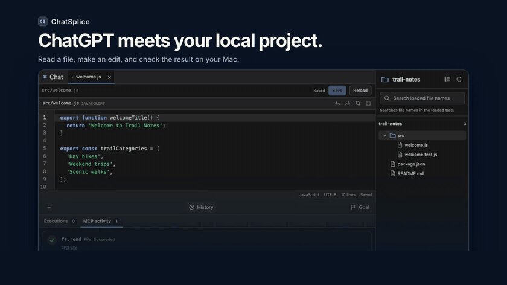

# ChatSplice

ChatSplice connects ChatGPT to folders you register on your Mac. Ask ChatGPT to edit a file or run a project check, then review the change and its output in the same window as your chat, editor, and terminal.

**macOS 14+ · Apple Silicon · Build from source · MIT**

[한국어](docs/ko/README.ko.md) · [Build and run](#build-and-run) · [Connect ChatGPT](#connect-chatgpt-and-try-a-read) · [Security](docs/security.md) · [Contributing](CONTRIBUTING.md)

[](docs/images/chatsplice-workflow.mp4)

The video follows a heading change in Trail Notes through the editor, test results, and browser check. The workflow ran through ChatSplice’s local MCP tools. [Open the MP4](docs/images/chatsplice-workflow.mp4)

## What you can do

- Ask ChatGPT to read or edit project files, run project checks, and perform supported Git operations.
- Run development commands, keep a local server running, and check a loopback web page with an isolated browser.
- Save project Goals with acceptance criteria and resume them when you return.
- Inspect changes in the file editor or use the integrated terminal yourself. The terminal is separate from the commands available through MCP.

## Build and run

Use Git, Node.js 24 (CI pins 24.18.0), pnpm 10.33.2, and the Xcode Command Line Tools for native dependencies. Run `xcode-select --install` if the tools are missing. If you use nvm, `nvm install` and `nvm use` select the version family in `.nvmrc`. If pnpm is missing, install the pinned version with `npm install -g pnpm@10.33.2`.

Clone this repository using the URL under **Code → HTTPS**, or download it using **Code → Download ZIP**. Run these commands from the source directory.

```bash
pnpm install --frozen-lockfile
pnpm build
pnpm start
```

The first launch downloads the pinned Electron runtime. For later source changes, use `pnpm dev` to rebuild and launch. Use `pnpm verify` to run the source checks, or see the distribution guide to build an unsigned app for your Mac. [Source distribution and updates](docs/release-distribution.md)

## Connect ChatGPT and try a read

1. Check that you can add custom MCP servers in your ChatGPT workspace and use Secure MCP Tunnel in your OpenAI Platform organization. A ChatGPT subscription alone does not guarantee either permission. [Custom MCP servers](https://developers.openai.com/api/docs/guides/custom-mcp-server) · [Secure MCP Tunnel](https://developers.openai.com/api/docs/guides/secure-mcp-tunnels)
2. Configure your own Tunnel and runtime key in **Connection management**, then add the server in ChatGPT through **Plugins → Add custom MCP server → Tunnel**. [Connection guide](docs/getting-started.md#connect-chatgpt)
3. Register a practice folder containing a `README.md`. Link a ChatGPT Project, start a new chat in it, and select the MCP app in the composer. Ask **“Read README.md in this project and summarize it.”** Look for `fs.read` in **History → MCP activity**.

Once the read succeeds, follow along with the Trail Notes project from the video. Register a copy of that folder and try the request below. [Trail Notes project](docs/examples/trail-notes/README.md)

> Change the title in `src/welcome.js` to “Plan your next hike”, then run `npm test`. Show me the change and the test result.

You can also link the Project and select the MCP app manually in ChatGPT web while ChatSplice is running. [Troubleshooting and manual setup](docs/onboarding.md)

## Know what you share

MCP results such as file contents, paths, command output, and local browser screenshots are sent to ChatGPT when a tool returns them. Start with a disposable folder and check your workspace's data policy before connecting sensitive files. Review write and execution requests before approving them. Developer shell commands can access the network by default; use `network: local` to block external network access. The manual terminal runs with your normal macOS permissions.

Enter Tunnel credentials in **Connection management**, not in repository files, Project instructions, or issue reports. See [security boundaries](docs/security.md) and [private vulnerability reporting](SECURITY.md).

## License and distribution

ChatSplice's own code is available under the [MIT license](LICENSE). Keep the copyright and license notice when redistributing it. [Third-party notices](THIRD_PARTY_NOTICES.md) cover dependencies under their respective licenses. ChatGPT is an OpenAI trademark used here to identify the service.

ChatSplice is an independent pre-release. Build it from source and set up your own permitted ChatGPT connection. [Publication checklist](RELEASE_CHECKLIST.md) · [MCP tools](docs/mcp-tools.md) · [Execution architecture](docs/execution-architecture.md)
