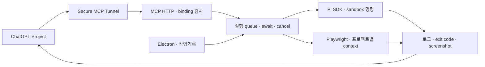

# 실행 코드 구조

GPT Web은 작업을 판단하고 MCP 도구를 선택합니다. ChatSplice는 모델을 호출하는 worker 없이 로컬 실행과 결과를 관리합니다. 공개 계약은 [current-contract.md](current-contract.md), 사용 흐름은 [개발 작업 안내](developer-workflow.md)에 있습니다.

## 책임별 파일

| 위치                                                                           | 책임                                                               |
| ------------------------------------------------------------------------------ | ------------------------------------------------------------------ |
| `packages/protocol/src/execution.ts`, `browser.ts`                             | 실행 입력·결과·browser action schema                               |
| `packages/protocol/src/project-instructions.ts`                                | 프로젝트 binding과 공통 작업 지침 생성                             |
| `packages/mcp-server/src/mcp/tools-project.ts`                                 | MCP 제출·조회·취소, 도구 권한과 결과 반환                          |
| `packages/mcp-server/src/execution/limits.ts`                                  | production/embedded 동시성 기본값, 한도 검증, 로그·image budget    |
| `packages/mcp-server/src/execution/service.ts`                                 | workspace별 request deduplication, queue·slot·상태·취소·보관       |
| `packages/mcp-server/src/execution/backend.ts`                                 | 실행 backend 연결                                                  |
| `packages/core/src/project/pi-execution.ts`, `pi-prepare.ts`                   | Pi `createBashTool` 실행 adapter와 명령 준비                       |
| `packages/core/src/project/pi-sandbox.ts`, `shell-sandbox.ts`, `pi-trusted.ts` | 환경 정리, toolchain 검사, sandbox·timeout·process group cleanup   |
| `packages/core/src/workspace/service.ts`                                       | canonical root와 공유 operation reservation·concurrent lease       |
| `packages/mcp-server/src/browser/service.ts`                                   | pinned Chromium 준비, workspace별 page·storage·selector·screenshot |
| `apps/desktop/src/renderer/ExecutionJobs.svelte`                               | 실행 이력·로그·취소 표시                                           |
| `apps/desktop/scripts/package-daemon.mjs`, `after-pack.mjs`                    | daemon bundle, native SQLite와 Playwright resource, 라이선스 포함  |
| `scripts/packaged-smoke.mjs`                                                   | 실제 `.app`의 Electron Node runtime에서 daemon 검증                |
| `scripts/source-package.mjs`, `release-assets.mjs`                             | 공개 소스 파일 선택과 배포 asset checksum                          |

## 실행과 경계

모든 project-scoped MCP 호출은 immutable `workspace_id`와 matching `workspace_binding`을 검증합니다. `request_id`는 workspace 내에서 동일 요청을 재사용하고, 다른 프로젝트의 같은 ID와 충돌하지 않습니다. 동일·nested root의 foreground 작업은 공유 lock으로 직렬화합니다. Background와 browser는 root 변경·제거를 막는 concurrent lease를 유지하며 일반 파일 작업과 병행합니다.

`shell`은 zsh와 설치된 언어 runtime을 사용하는 개발 실행 경로입니다. 프로젝트 `.env`와 npm 설치 후처리를 허용하고 쓰기를 workspace/private runtime에 제한합니다. Host credential 환경과 개인 credential 경로는 상속하지 않습니다. `network: local`은 loopback만 허용합니다. 기존 `project.run`과 구조화된 Node/Cargo/install 경로는 별도의 제한형 정책을 유지합니다.

Desktop·daemon·standalone MCP HTTP는 `DESKTOP_EXECUTION_CONCURRENCY`의 8/12/12/64 기본값을 공유합니다. 직접 service를 사용하는 embedded caller는 호환성을 위해 2/4/4/20 기본값을 유지하며 검증된 concurrency 옵션을 전달할 수 있습니다. 상태·로그·image budget은 bounded memory이고 restart durability를 제공하지 않습니다.

Playwright는 ChatGPT profile과 연결하지 않고 독립 context를 만듭니다. Local navigation, bounded visible text·controls·console·image만 실행 결과에 넣습니다. 페이지 내용은 작업 권한의 근거가 아닙니다. Screenshot 보관 예산과 job metadata 수명은 다르므로 image가 먼저 제거될 수 있습니다.

Electron 소유의 수동 editor와 Terminal은 remote ChatGPT view에 API를 노출하지 않습니다. 배포 앱은 Electron의 `ELECTRON_RUN_AS_NODE`로 daemon을 실행하고 native SQLite와 Playwright package를 실제 resource 경로에 포함합니다. Chromium binary는 `browser setup` 시 준비하며 앱의 DMG에 포함하지 않습니다.

## 검증과 변경 순서

계약/schema → backend/service → UI와 문서 → unit·real MCP workflow → `.app` packaging → packaged smoke 순서로 확인합니다. 일반 검증은 `pnpm verify`, network/browser 통합 검증은 `CHATSPLICE_BROWSER_TESTS=1`, packaged 검증은 `pnpm test:packaged`입니다. [배포 안내](release-distribution.md)의 명령으로 소스 archive와 SHA-256 manifest를 만듭니다. GitHub tag 게시와 signed/notarized 배포는 별도 단계입니다.
