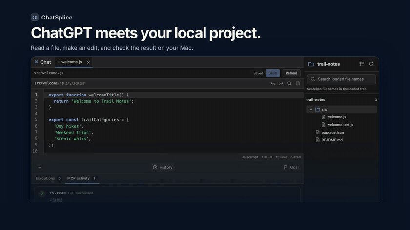

# ChatSplice

ChatSplice는 ChatGPT를 내 Mac에 등록한 프로젝트 폴더와 연결합니다. ChatGPT에 파일 수정이나 테스트를 요청하고, 같은 창의 에디터와 터미널에서 변경 내용과 실행 결과를 확인할 수 있습니다.

**macOS 14 이상 · Apple Silicon · 소스 빌드 · MIT**

[English](../../README.md) · [빌드하고 실행하기](#빌드하고-실행하기) · [ChatGPT 연결](#chatgpt에-연결하고-첫-읽기-요청하기) · [보안](../security.md) · [기여](../../CONTRIBUTING.md)

[](../images/chatsplice-workflow.mp4)

Trail Notes의 제목을 바꾸고, 테스트 결과와 바뀐 웹 화면을 확인하는 과정입니다. 영상 속 작업은 ChatSplice의 로컬 MCP 도구로 실행했습니다. [MP4 열기](../images/chatsplice-workflow.mp4)

## 무엇을 할 수 있나요?

- ChatGPT에 프로젝트 파일 읽기·수정, 프로젝트 검사, 지원하는 Git 작업을 요청할 수 있습니다.
- 개발 명령을 실행하고 서버를 켜 둔 채 수정하며, 별도의 브라우저에서 로컬 페이지를 확인할 수 있습니다.
- 프로젝트 목표와 완료 기준을 저장해 다음 작업에서 이어갈 수 있습니다.
- 에디터에서 변경을 검토하거나 내장 터미널에 직접 명령을 입력할 수 있습니다. 내장 터미널은 MCP 명령 실행과 분리되어 있습니다.

## 빌드하고 실행하기

Git, Node.js 24(CI는 24.18.0 사용), pnpm 10.33.2, 네이티브 의존성용 Xcode Command Line Tools가 필요합니다. Command Line Tools가 없으면 `xcode-select --install`로 설치합니다. nvm을 쓰면 `nvm install`, `nvm use`로 `.nvmrc`에 지정된 버전 계열을 사용합니다. pnpm이 없다면 `npm install -g pnpm@10.33.2`로 설치합니다.

GitHub의 **Code → HTTPS**에 표시되는 URL로 clone하거나 **Code → Download ZIP**에서 소스를 받습니다. 소스 폴더를 터미널에서 열고 실행합니다.

```bash
pnpm install --frozen-lockfile
pnpm build
pnpm start
```

첫 실행에서 지정된 Electron 런타임을 내려받습니다. 소스를 고친 뒤에는 `pnpm dev`로 다시 빌드하고 실행합니다. 기여 전 전체 소스 검사는 `pnpm verify`를 사용합니다. 본인 Mac에 설치할 unsigned 앱이 필요하면 [직접 빌드 및 업데이트 안내](../release-distribution.md)를 참고하세요.

## ChatGPT에 연결하고 첫 읽기 요청하기

1. ChatGPT 워크스페이스에서 커스텀 MCP 서버를 추가할 수 있는지, OpenAI Platform 조직에서 Secure MCP Tunnel을 사용할 수 있는지 확인합니다. 두 권한은 ChatGPT 구독과 별개입니다. [커스텀 MCP 서버](https://developers.openai.com/api/docs/guides/custom-mcp-server) · [Secure MCP Tunnel](https://developers.openai.com/api/docs/guides/secure-mcp-tunnels)
2. ChatSplice의 **연결 관리**에서 본인의 Tunnel과 runtime key를 설정한 뒤, ChatGPT의 **Plugins → Add custom MCP server → Tunnel**에서 서버를 추가합니다. [연결 안내](../onboarding.md)
3. `README.md`가 있는 연습용 폴더를 등록합니다. ChatGPT 프로젝트를 연결하고 그 안에서 새 대화를 연 뒤, 입력창에서 MCP 앱을 선택합니다. **“이 프로젝트의 README.md를 읽고 요약해 주세요.”**라고 요청하고 **작업기록 → MCP 작업**에 `fs.read`가 표시되는지 확인합니다.

첫 읽기가 성공하면 영상 속 Trail Notes 폴더를 복사해 등록하고 아래 요청을 해 보세요. [Trail Notes 프로젝트](../examples/trail-notes/README.md)

> `src/welcome.js`의 제목을 “Plan your next hike”로 바꾸고 `npm test`를 실행해 주세요. 변경 내용과 테스트 결과를 보여 주세요.

ChatSplice를 켜 둔 채 일반 브라우저의 ChatGPT에서도 프로젝트를 연결하고 MCP 앱을 선택할 수 있습니다. [수동 설정과 문제 해결](../onboarding.md#문제-해결)

## 어떤 데이터가 전달되나요?

MCP가 반환한 파일 내용, 경로, 명령 출력, 로컬 브라우저 스크린샷은 ChatGPT로 전달됩니다. 연습용 폴더로 시작하고, 업무 자료를 연결하기 전에는 워크스페이스의 데이터 정책을 확인하세요. 쓰기·실행 요청은 승인 전에 검토합니다. 개발 shell은 기본적으로 외부 네트워크에 접속할 수 있고, 외부 접속을 막으려면 `network: local`을 사용합니다. 사용자가 직접 조작하는 터미널은 일반 macOS 사용자 권한으로 실행됩니다.

Tunnel 인증 정보는 **연결 관리**에 입력하세요. 저장소, 프로젝트 지침, 오류 신고에는 넣지 않습니다. 자세한 경계는 [보안 안내](../security.md)와 [비공개 취약점 신고](../../SECURITY.md)에 있습니다.

## 라이선스와 공개 범위

ChatSplice 자체 코드는 [MIT 라이선스](../../LICENSE)를 적용합니다. 재배포할 때 저작권과 라이선스 고지를 함께 유지하세요. 의존성에는 각각의 라이선스가 적용됩니다. [외부 라이브러리 고지](../../THIRD_PARTY_NOTICES.md)를 참고하세요. ChatGPT는 연동 대상 서비스를 가리키는 OpenAI의 상표입니다.

ChatSplice는 독립 프로젝트의 사전 공개 버전입니다. 각자 소스를 빌드하고 본인 계정에서 허용된 ChatGPT 연결을 설정해 사용합니다. [공개 검증 체크리스트](../../RELEASE_CHECKLIST.md) · [MCP 도구](../mcp-tools.md) · [실행 코드 구조](../execution-architecture.md)
